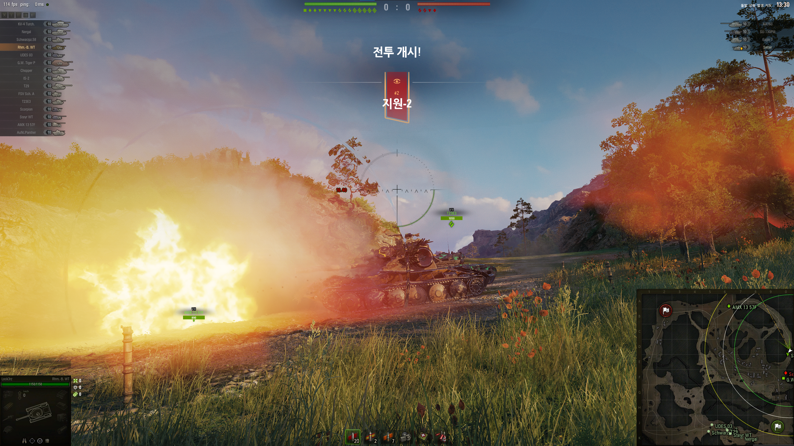

# OffHangar Replay

[한국어](README.md) · **English**

Record offline battles in **World of Tanks EU 2.3.1.2 (Windows x64)** with **OffHangar 2.0 LAN**. The mod saves each battle as a `.wotreplay` that opens in the game's built-in replay player. Install the same client and mod on the playback PC to see the battle log, radio commands, consumables and other recorded HUD details.



## How it works

1. **Recording the battle.** When recording is on, the mod periodically samples vehicle positions, turret angles and the player's camera. It also records changes such as shots, hits and shell selections with the time elapsed since the battle began. In player-view mode, it tracks only the vehicles visible to the player at the time.
2. **Creating the replay file.** When the battle ends, the mod finishes writing the `.ohtrack` file in `replays\offhangar` and starts `export.exe`. The converter uses `bootstrap.dat` to initialize the replay, then writes the recorded map, vehicle roster and timed events into a `.wotreplay` file. This all happens on your PC.
3. **Playing it back.** When you open the file, the game engine renders the battle from the recorded positions and events. The mod updates the HUD on the same timeline. For example, when playback reaches a shell change, the HUD selects the corresponding slot and shows how many rounds of that type remain.

## Installation

1. Download `offhangar-replay-2.3.1.2-win64.zip` from the [latest release](https://github.com/hillofsky/offhangar-replay/releases/latest) and extract it into its own folder.
2. Close the game. The ZIP includes the initialization data for EU 2.3.1.2.
3. Open PowerShell in the extracted folder and run the command below. Replace the example path with the root folder of your OffHangar game installation.

```powershell
powershell -NoProfile -ExecutionPolicy Bypass -File .\Install.ps1 -GameDir "D:\Games\World_of_Tanks"
```

A fresh installation uses the bundled `bootstrap.dat`. An update reuses the installed template. To supply your own, add `-Replay "D:\Replays\my-native-battle.wotreplay"` to the command. This option accepts a compatible replay recorded by the original client on the same build.

## Recording and playback

Choose a replay recording mode in the game settings before starting an offline battle. After the battle ends, open the finished replay from the game's `replays` folder.

| In-game setting | Files saved |
| --- | --- |
| Off | No new recording. |
| Last | Each completed battle replaces `OffHangar-last.wotreplay`. |
| All | Each battle gets a separate, timestamped `OffHangar-*.wotreplay`. |

By default, the mod records only vehicles visible to the player. To record all vehicles, press **Ctrl + Alt + F9** in the Garage or open `mods\offhangar-fleet\FleetReplaySettings.exe`. The change applies to the next battle. The in-game setting above controls how many replay files you keep.

### What gets recorded

- The countdown once the vehicle is ready, and the remaining battle time.
- Fallen trees and columns, broken props, and destroyed building sections. Starting with v1.0.5, the recorder saves the object identity, destruction time, and fall direction so the client can apply the effect on the map.
- Seconds remaining in the prebattle message. Standard allied and enemy overhead markers show tank tiers by default.
- Recorded player shot results drive the client's own penetration, non-penetration and ricochet audio. Older replays use a generic hit confirmation for recorded non-lethal shell damage to an enemy.
- Starting with v1.0.6, new recordings preserve hit marks on vehicle armor, including penetrations. Marks appear, change and disappear as they did in battle. Earlier recordings lack this decal history.
- Hull auto-rotation, cruise control, player vehicle fires, and kill and critical hit feedback.
- The winner or draw and finish reason when OffHangar resolves a battle. The native client uses the result to select the ending music. Leaving early produces no result.
- Current hit points and the health bar on the lower-left vehicle panel.
- Module damage and destruction, automatic repair progress, repairs and crew injuries and recovery on the same panel. Per-module states are saved in battles recorded with this feature installed.
- Vehicle movement and orientation, turret and gun movement, shots, hits, vehicle destruction, the player's camera and sniper view.
- Aiming circle, reload state, Sixth Sense, radio commands and the outline of the vehicle under the reticle.
- Rounds remaining by shell type, rounds in the magazine, current and next shell selections, consumable quantities and cooldowns.
- The lower-left battle log and its totals. The original HUD shows damage dealt, assisted, blocked and received, as well as damage to modules and crew.

## Compatibility and troubleshooting

- To correct the countdown in an older replay, update the mod and rebuild from the original `.ohtrack`. Run this command in the game folder with your track filename and a new output filename. If the older track missed the countdown reset, the converter uses the recorded battle start time.

```powershell
.\mods\offhangar-fleet\export.exe --rebuild ".\replays\offhangar\BATTLE.ohtrack" ".\replays\countdown-fixed.wotreplay"
```

- The supported base mod is `mods\2.3.1.2\offhangar2_lan_2312.wotmod`. Install the game and OffHangar 2.0 LAN first.
- If conversion fails, open the file ending in `.export-error.txt` in `replays\offhangar` for details.
- Replays and privately supplied templates can contain player names and battle identifiers. When reporting an issue, start with the client version, map, recording mode and replay timestamp.

## Build from source

You need Windows x64, 64-bit Python 3.12, the supported game client and the .NET Framework 4.x C# compiler. The build compiles in-game Python modules with the client's `win64\python27.dll`.

```powershell
py -3.12 -m venv .venv
.\.venv\Scripts\python.exe -m pip install -r requirements-build.txt
.\.venv\Scripts\python.exe .\tools\build.py "D:\Games\World_of_Tanks"
```

The `build` folder contains the Windows release ZIP and `SHA256SUMS.txt`. The ZIP includes six mod packages, the converter, the recording-scope utility, the replay template, the installer and third-party notices.

| Path | Contents |
| --- | --- |
| `src/mod_oh2_*.py` | In-game recording and playback modules |
| `src/fleet_export.py`, `src/replay_sample.py` | Recording conversion and native replay container handling |
| `src/FleetReplaySettings.cs` | Recording-scope utility |
| `tools/` | Windows release build scripts |
| `templates/bootstrap.dat` | Bundled replay initialization data |
| `Install.ps1` | Template validation and installation |

## Uninstall

Close the game. In `mods\2.3.1.2`, remove `oh2-fleet.wotmod`, `oh2-fleet-animation.wotmod`, `oh2-fleet-hud.wotmod`, `oh2-fleet-radio.wotmod`, `oh2-fleet-status.wotmod` and `oh2-replay-compat.wotmod`. The converter and its settings are in `mods\offhangar-fleet`. Saved battles are in `replays`.
