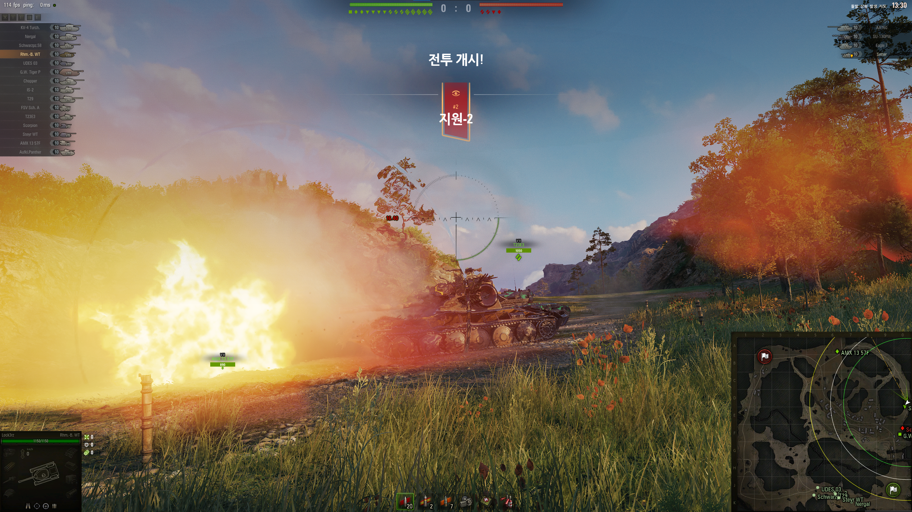

# OffHangar Replay

**한국어** · [English](README.en.md)

월드 오브 탱크 **EU 2.3.1.2 (Windows x64)** 및 **OffHangar 2.0 LAN**용 오프라인 전투 리플레이 모드입니다. 전투 종료 후 게임의 기본 재생기로 열 수 있는 `.wotreplay`를 만듭니다. 재생할 PC에도 같은 클라이언트와 이 모드를 설치해야 전투 기록, 무전, 소모품 등 추가 HUD 기능을 볼 수 있습니다.



## 작동 원리

1. **전투 기록.** 녹화가 켜져 있으면 모드가 전차 위치와 포탑 방향, 플레이어 카메라를 주기적으로 읽습니다. 발사·피격·탄종 전환처럼 상태가 바뀌는 순간에는 전투 시작 후 경과 시간과 함께 변경 내용을 기록합니다. 플레이어 시점 녹화에서는 당시 플레이어에게 표시되는 전차만 추적합니다.
2. **파일 변환.** 전투가 끝나면 모드가 `replays\offhangar`에 `.ohtrack` 파일을 완성하고 `export.exe`를 실행합니다. 변환기는 `bootstrap.dat`를 바탕으로 재생기의 초기 상태를 구성하고, 방금 기록한 전투의 지도·전차 목록과 시간순 이벤트를 담아 `.wotreplay`를 만듭니다. 이 과정은 PC 안에서 이루어집니다.
3. **장면 재생.** 파일을 열면 게임 엔진이 기록된 위치와 이벤트에 따라 전투 장면을 다시 그립니다. 모드는 같은 재생 시간에 맞춰 HUD를 갱신합니다. 예를 들어 전투 중 탄종을 바꾸면 리플레이에서도 그 시점에 해당 탄종 슬롯이 선택되고 그 탄종의 잔탄이 표시됩니다.

## 설치

1. [최신 릴리스](https://github.com/hillofsky/offhangar-replay/releases/latest)에서 `offhangar-replay-2.3.1.2-win64.zip`을 받아 별도 폴더에 압축을 풉니다.
2. 게임을 닫습니다. 배포 ZIP에 EU 2.3.1.2용 리플레이 초기 데이터가 들어 있습니다.
3. 압축을 푼 폴더에서 PowerShell을 열고 아래 명령을 실행합니다. 게임 경로를 본인의 설치 폴더로 바꿉니다.

```powershell
powershell -NoProfile -ExecutionPolicy Bypass -File .\Install.ps1 -GameDir "D:\Games\World_of_Tanks"
```

신규 설치에서는 동봉한 `bootstrap.dat`를 사용하고, 업데이트에서는 기존 템플릿을 재사용합니다. 별도 템플릿을 쓰려면 설치 명령에 `-Replay "D:\Replays\my-native-battle.wotreplay"`를 추가하세요. 이 옵션은 호환되는 같은 버전의 기본 게임 리플레이를 받습니다.

## 녹화와 재생

게임 설정에서 녹화 방식을 선택한 다음 오프라인 전투를 시작합니다. 전투가 끝나면 게임 폴더의 `replays`에서 완성된 파일을 열 수 있습니다.

| 게임 설정 | 저장 결과 |
| --- | --- |
| 끄기 | 새 전투를 녹화하지 않습니다. |
| 최근 | `OffHangar-last.wotreplay`를 마지막 전투로 갱신합니다. |
| 전체 | 전투마다 날짜·시간이 붙은 `OffHangar-*.wotreplay`를 저장합니다. |

기본값은 **플레이어에게 표시된 전차만 녹화**입니다. 차고에서 `Ctrl + Alt + F9`를 누르거나 `mods\offhangar-fleet\FleetReplaySettings.exe`에서 전체 전차 녹화로 바꿀 수 있습니다. 다음 전투부터 적용됩니다. 이 선택은 전차의 기록 범위를 정합니다. 파일 보관 개수는 위의 게임 설정에서 선택합니다.

### 기록되는 전투 정보

- 차량 로딩 후 실제로 시작된 카운트다운과 전투 제한 시간
- 전투 중 쓰러진 나무·기둥과 파괴된 소품·건물 부위. 녹화기는 물체 식별자와 파괴 시각, 쓰러지는 방향을 저장하고 재생기는 해당 지도에서 효과를 적용합니다. 이 정보는 v1.0.5부터 기록합니다.
- 전투 준비 문구에 남은 초를 표시합니다. 일반 아군·적군 마커에는 기본으로 전차 티어를 표시합니다.
- 플레이어 사격의 명중 결과를 기록해 관통·비관통·도탄 등에 맞는 기본 게임 음성을 재생합니다. 이전 리플레이에서는 기록으로 확인되는 적 전차의 비치명 포탄 피해에 한해 일반 명중음을 복원합니다.
- 자동 차체 회전, 순항 주행, 내 전차의 화재 상태와 격파·치명타 전투 알림
- OffHangar가 판정한 승리·패배·무승부와 종료 사유. 기본 재생기가 이 신호로 전투 종료 음악을 선택합니다. 도중에 차고로 나가면 결과가 기록되지 않습니다.
- 왼쪽 하단 전차 상태 패널의 현재 내구도(HP)와 내구도 막대
- 피격 방향 표시에는 피해량과 식별된 공격 전차 이름을 표시합니다. v1.0.7부터 이탈리아식 자동 재장전의 포탄별 남은 시간, 기지 점령과 경보음, 전투 공개 명단과 격파 시각도 기록합니다. 플레이어 시점에서는 미발견 전차의 위치를 기록하지 않습니다.
- 같은 패널에 표시되는 부품 손상·파괴, 자동 수리 진행, 수리 키트 사용 후 상태와 승무원 부상·치료. 부품별 상태는 이 기능을 설치한 뒤 녹화한 전투부터 저장합니다.
- 전차 이동과 방향, 포탑·포신 회전, 발사·피격·격파, 플레이어 카메라와 저격 시점
- v1.0.6부터 전차 장갑에 남는 관통·피탄 자국을 기록합니다. 전투에서 자국이 교체되거나 사라지면 리플레이에도 반영됩니다. 이전 녹화에는 탄흔 목록이 없습니다.
- 조준원·장전 상태, 육감, 무전 명령, 조준한 전차의 윤곽선
- 탄종별 잔탄과 탄창, 현재·다음 탄종, 소모품 수량과 재사용 대기시간
- 왼쪽 하단 전투 기록과 누적 합계. 가한 피해, 도움 피해, 막은 피해, 받은 피해와 부품·승무원 피해를 원래 HUD로 표시합니다.
- 화면 중앙의 전투 리본은 전투 중 실제로 표시된 종류·수치·전차명·누적 갱신을 기록합니다. 예를 들어 충각으로 받은 피해와 가한 피해는 빨강·초록 리본에 각각 표시됩니다. 이전 녹화는 저장된 전투 이벤트로 리본을 복원합니다.
- 미니맵의 아군 위치와 상단 전차 생존 상태도 재생합니다. 예전 녹화는 원본 `.ohtrack`으로 다시 변환하면 관측된 위치와 잔해를 복구할 수 있습니다. 당시 명단에서 빠진 전차는 복구할 수 없습니다.

## 호환성과 문제 확인

- 기존 리플레이의 카운트다운이 어긋나고 원본 `.ohtrack`이 남아 있다면 업데이트 후 새 파일로 변환할 수 있습니다. 게임 폴더에서 아래 명령의 입력 이름을 실제 전투 기록으로 바꾸고, 출력에는 새 이름을 지정하세요. 이전 기록에 카운트다운 변경 시각이 빠진 경우 변환기는 기록된 전투 시작 시각을 사용합니다.

```powershell
.\mods\offhangar-fleet\export.exe --rebuild ".\replays\offhangar\BATTLE.ohtrack" ".\replays\countdown-fixed.wotreplay"
```

- 지원 대상으로 확인한 기반 모드는 `mods\2.3.1.2\offhangar2_lan_2312.wotmod`입니다. 설치하려는 PC에 해당 모드와 게임이 먼저 있어야 합니다.
- 변환에 실패하면 `replays\offhangar`에서 이름이 `.export-error.txt`로 끝나는 파일을 열어 원인을 확인하세요.
- 리플레이 또는 `bootstrap.dat`에는 전차장 이름과 전투 식별 정보가 포함될 수 있습니다. 오류 제보에는 우선 게임 버전, 지도, 녹화 모드, 문제가 발생한 재생 시각을 적어 주세요.

## 소스에서 빌드

Windows x64, 64비트 Python 3.12, 위 게임 설치본, .NET Framework 4.x C# 컴파일러가 필요합니다. 게임 내 모듈은 해당 클라이언트의 `win64\python27.dll`로 컴파일합니다.

```powershell
py -3.12 -m venv .venv
.\.venv\Scripts\python.exe -m pip install -r requirements-build.txt
.\.venv\Scripts\python.exe .\tools\build.py "D:\Games\World_of_Tanks"
```

`build`에 Windows 배포 ZIP과 `SHA256SUMS.txt`가 생성됩니다. 배포 ZIP에는 모드 6개, 변환기, 녹화 범위 설정 도구, 설치 스크립트와 번들 라이브러리 고지가 포함됩니다.

| 경로 | 내용 |
| --- | --- |
| `src/mod_oh2_*.py` | 게임 안에서 실행되는 녹화·재생 모듈 |
| `src/fleet_export.py`, `src/replay_sample.py` | 전투 기록 변환과 네이티브 리플레이 컨테이너 처리 |
| `src/FleetReplaySettings.cs` | 녹화 범위 설정 도구 |
| `tools/` | Windows 배포본 빌드 |
| `templates/bootstrap.dat` | 기본 설치에 사용하는 재생 초기 데이터 |
| `Install.ps1` | 호환 템플릿 검사와 설치 |

## 제거

게임을 닫고 `mods\2.3.1.2`에서 `oh2-fleet.wotmod`, `oh2-fleet-animation.wotmod`, `oh2-fleet-hud.wotmod`, `oh2-fleet-radio.wotmod`, `oh2-fleet-status.wotmod`, `oh2-replay-compat.wotmod`를 제거합니다. 변환기와 설정은 `mods\offhangar-fleet`에 있습니다. 저장한 전투는 `replays`에 있습니다.
